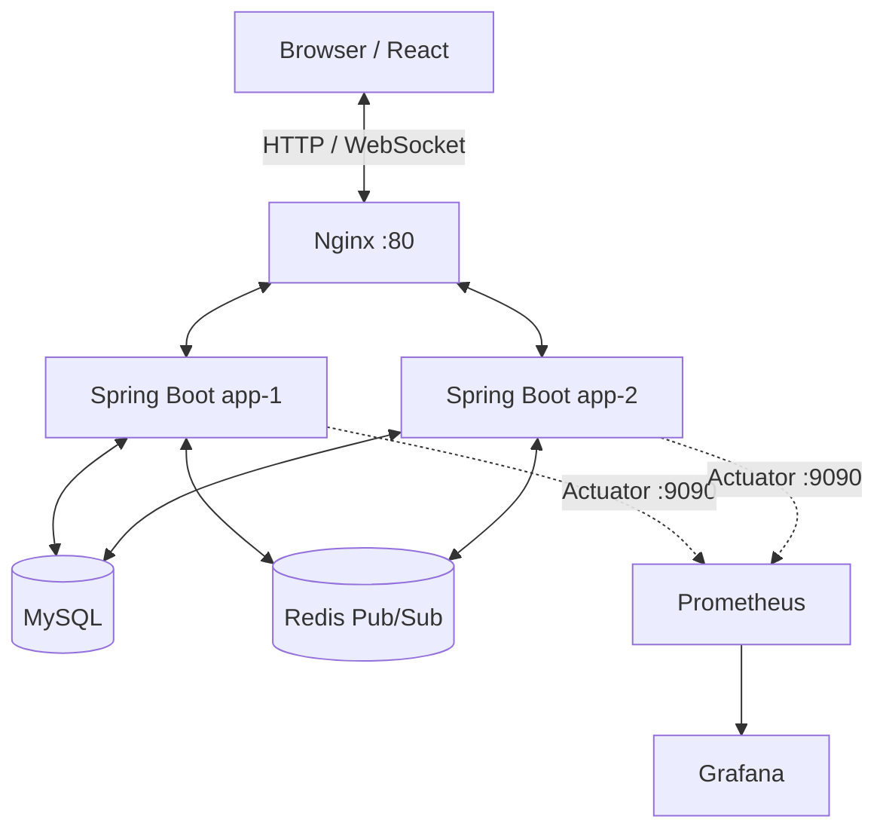

# RealTimeChat

Java 21 · Spring Boot · React · WebSocket/STOMP · MySQL · Redis Pub/Sub · Docker · Nginx · k6

Spring Boot와 React로 구현한 실시간 채팅 포트폴리오 프로젝트입니다. 세션 인증과 채팅방 접근 제어를 적용하고, Redis Pub/Sub으로 두 Spring Boot 인스턴스 사이의 메시지와 읽음 상태를 전달합니다.

## 주요 기능

- 회원가입·로그인·로그아웃 및 HTTP Session 인증
- 채팅방 생성·참여, 메시지 저장 및 이전 대화 조회
- WebSocket/STOMP 기반 실시간 메시지 송수신
- 사용자별 읽음 위치와 메시지별 미읽음 인원 수 표시
- 닉네임 변경 및 메시지 URL 링크 처리
- Redis Pub/Sub을 이용한 다중 인스턴스 메시지·읽음 상태 중계
- Docker Compose 기반 MySQL·Redis·Spring Boot 2개 인스턴스 실행
- Actuator/Micrometer 메트릭 및 선택형 Prometheus/Grafana 모니터링
- k6 기반 WebSocket·교차 인스턴스 전달 부하 테스트

## 기술 스택

| 영역 | 기술 |
|---|---|
| Backend | Java 21, Spring Boot 4.1.1, Spring Security, Spring Data JPA |
| Frontend | React, React Router, Vite |
| Realtime | WebSocket, STOMP |
| Data / Messaging | MySQL 8, Redis Pub/Sub |
| Infrastructure | Docker Compose, Nginx |
| Monitoring / Test | Actuator, Micrometer, Prometheus, Grafana, k6 |
| CI/CD | GitHub Actions, self-hosted Windows runner, EC2 SSH deployment |

## 아키텍처



메시지는 서버에서 권한을 검증하고 DB에 저장한 뒤 Redis Pub/Sub으로 다른 인스턴스에 전달됩니다. 모니터링 컨테이너는 기본 실행에서 제외되어 있으며 필요할 때만 시작합니다.

## 로컬 개발

### 사전 준비

- Git
- JDK 21
- Node.js/npm
- Docker Desktop
- Windows PowerShell

프로젝트 루트에서 `.env.example`을 참고해 `.env`를 만들고 필요한 값을 설정합니다. 실제 비밀번호가 담긴 `.env`는 커밋하지 마세요.

### 실행

```powershell
.\start-local.ps1
```

- React UI: http://localhost:5173/ui/
- Spring Boot: http://localhost:8080
- 로컬 MySQL: localhost:3307
- 로컬 Redis: localhost:6379

로컬 MySQL은 별도 Docker 컨테이너의 3307 포트를 사용하므로 Windows의 MySQL 서비스와 분리됩니다. 종료할 때는 `.\stop-local.ps1`을 실행합니다. DB 데이터 볼륨은 유지됩니다.

개별 Compose 서비스가 필요하면 [Docker 가이드](docs/DOCKER.md)를 참고하세요. 모니터링은 다음 명령으로 별도 실행합니다.

```powershell
docker compose --profile monitoring up -d
```

### k6 부하 테스트

Docker Compose로 app-1/app-2를 실행하고 k6를 설치한 뒤, 테스트용 DB에서 실행합니다.

```powershell
k6 run -e BASE_URL_1=http://localhost:8080 -e BASE_URL_2=http://localhost:8081 k6/chat-load.js
```

테스트 계정과 채팅방이 DB에 생성되므로 운영 DB에서 실행하지 마세요. 자세한 내용은 [k6 가이드](docs/K6.md)를 참고하세요.

## 최근 성능 측정

DB 메시지 저장 경로에서 동일 채팅방 행의 비관적 쓰기 잠금을 제거한 뒤 측정한 기록입니다. 아래 수치는 특정 테스트 실행의 결과이며 성능 보장은 아닙니다.

| 환경 / 조건 | 전송·수신 | 평균 전달 시간 | p95 | 최대 |
|---|---:|---:|---:|---:|
| 로컬 · 2 VU · 30초 · 250ms 간격 | 232 / 232 | 26.42ms | 39.69ms | 494ms |
| EC2 · 2 VU · 30초 · 250ms 간격 | 232 / 232 | 27.3ms | 68.69ms | 277ms |
| EC2 · 2 VU · 60초 · 100ms 간격 | 1158 / 1158 | 18.96ms | 34ms | 171ms |

전달 지연은 개선됐지만, 강한 테스트에서 메시지 순서 역전 6건과 도착 시점 sequence gap 6건이 기록됐습니다. gap 측정은 실제 유실과 늦은 도착을 구분하도록 추가 검증이 필요하며 **메시지 순서 보장은 아직 미해결**입니다.

## CI/CD

- **CI** — Pull Request 생성 시 GitHub Actions가 JDK 21, MySQL, Redis 환경에서 Gradle 테스트를 실행합니다.
- **EC2 자동 배포** — `main` push 시 [`deploy-ec2.yml`](.github/workflows/deploy-ec2.yml)이 self-hosted Windows runner에서 SSH로 EC2에 접속해 최신 `main`을 배포합니다. 필요한 GitHub Secret은 `EC2_SSH_KEY_B64`입니다.
- **수동 Windows Compose workflow** — [`deploy.yml`](.github/workflows/deploy.yml)은 기존 Windows Docker 환경용으로 수동 실행만 허용합니다.

배포 결과는 [GitHub Actions](https://github.com/zuzusnasna/RealTimeChat/actions)에서 확인하세요. Workflow 성공과 별도로 실제 사이트의 로그인·채팅 동작도 확인해야 합니다.

## 문서

- [프로젝트 총정리 보고서](docs/PROJECT-REPORT.md) — 아키텍처, 기능, 개선 내역, 성능 결과, 미해결 과제
- [개선 이력](docs/PROJECT-IMPROVEMENTS.md) — 성능 측정 및 되돌린 시도
- [저장소 구조](docs/PROJECT-STRUCTURE.md) — 폴더·파일 책임과 정리 기준
- [로컬 개발 가이드](docs/LOCAL-DEVELOPMENT.md)
- [Docker Compose 가이드](docs/DOCKER.md)
- [모니터링 가이드](docs/MONITORING.md)
- [k6 가이드](docs/K6.md)
- [EC2 성능 분석](docs/EC2-PERFORMANCE-ANALYSIS.md)

## 다음 과제

- [ ] 메시지 순서·중복·실제 유실을 구분할 수 있도록 k6 검증 로직 개선
- [ ] 메시지 저장부터 Redis 발행, listener, STOMP 전송까지 단계별 지연 추적
- [ ] 채팅방 단위 순서 보장 방식을 별도 브랜치에서 검증
- [ ] EC2 배포 후 헬스 체크와 자원 관측 강화
