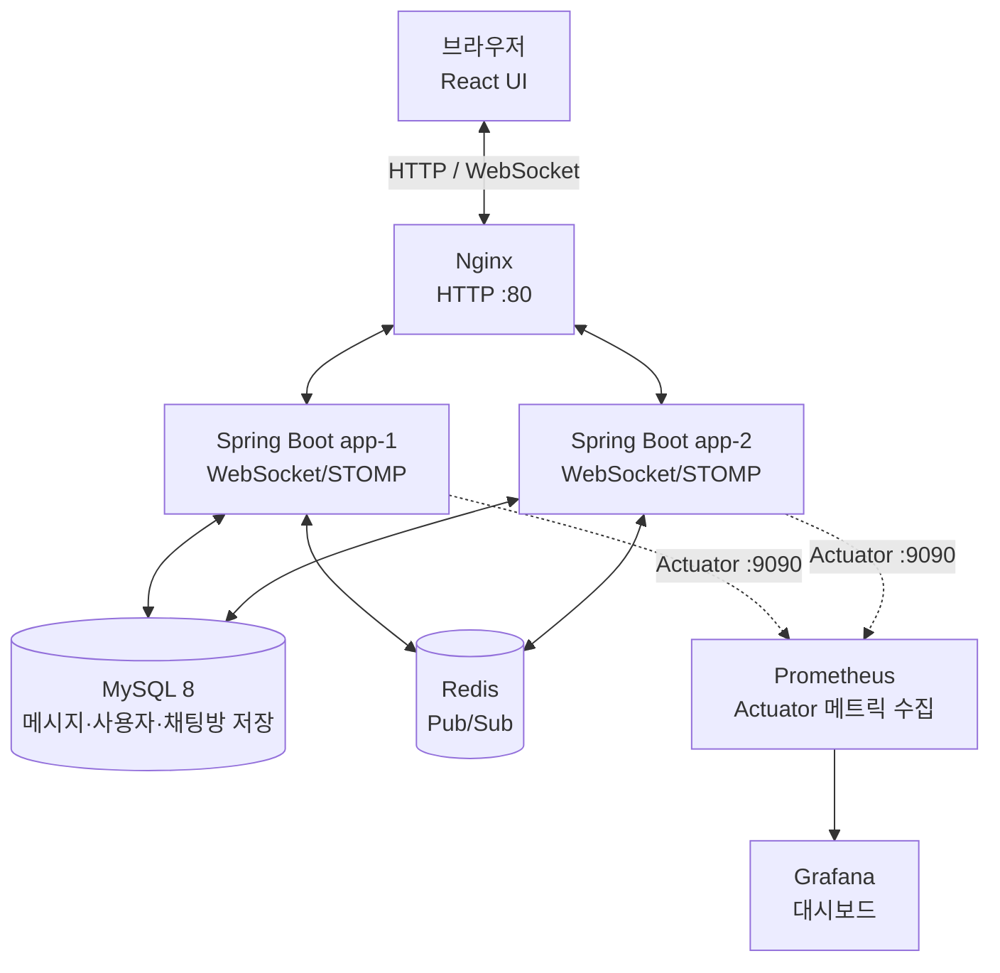

# RealTimeChat

**Java 21 · Spring Boot · React · WebSocket/STOMP · MySQL · Redis Pub/Sub · Docker Compose · Prometheus · Grafana · k6**

Spring Boot와 React 기반의 실시간 채팅 서비스입니다. 세션 인증과 채팅방 접근 제어를 적용하고, Redis Pub/Sub으로 다중 Spring Boot 인스턴스 사이의 메시지와 읽음 상태를 전달합니다.

## 주요 기능

- 회원가입·로그인·로그아웃 및 HTTP Session 인증
- 채팅방 생성·참여, 메시지 저장 및 이력 조회
- WebSocket/STOMP 기반 실시간 메시지 송수신
- 채팅방별 읽음 위치 저장 및 메시지별 미읽음 인원 수 표시
- 인증 사용자 기반 발신자 처리 및 채팅방 참여 권한 검증
- Redis Pub/Sub을 이용한 다중 인스턴스 메시지·읽음 상태 중계
- Docker Compose 기반 MySQL·Redis·Spring Boot 2개 인스턴스 구성
- Spring Boot Actuator·Micrometer 메트릭 수집, Prometheus·Grafana 모니터링
- k6를 이용한 WebSocket 연결, 메시지 송수신 및 인스턴스 간 전달 부하 테스트

## 기술 스택

| 구분 | 기술 |
|---|---|
| Backend | Java 21, Spring Boot 4.1.1, Spring Security, Spring Data JPA |
| Frontend | React, React Router, Vite |
| Real-time | WebSocket, STOMP |
| Database / Messaging | MySQL 8, Redis Pub/Sub |
| Infrastructure | Docker, Docker Compose, Nginx |
| Monitoring / Test | Spring Boot Actuator, Micrometer, Prometheus, Grafana, k6 |
| CI/CD | GitHub Actions, self-hosted Windows runner |

## 아키텍처

GitHub에서 아래 Mermaid 다이어그램을 렌더링해 서비스 구성을 확인할 수 있습니다.



- **메시지 흐름:** 클라이언트가 WebSocket/STOMP로 메시지를 전송하면 서버가 권한을 검증하고 메시지를 저장한 뒤, Redis Pub/Sub을 통해 다른 인스턴스에 연결된 클라이언트에도 전달합니다.
- **읽음 처리:** 서버가 사용자별 마지막 읽은 메시지 위치를 저장하고, 메시지별 미읽음 인원 수를 계산합니다. 읽음 상태 변경은 Redis Pub/Sub을 통해 인스턴스 사이에 전달됩니다.
- **모니터링:** Prometheus가 각 인스턴스의 Actuator 메트릭을 수집하고 Grafana가 이를 시각화합니다.

## 로컬 실행

### 1. 환경 변수 준비

Docker Desktop을 실행하고 프로젝트 루트에서 `.env.example`을 참고해 `.env` 파일을 만듭니다. 필수 DB 및 Grafana 비밀번호를 설정하세요. 실제 비밀번호가 포함된 `.env`는 Git에 커밋하지 마세요.

### 2. 서비스 시작

```powershell
docker compose up --build -d
docker compose ps
```

- 채팅 UI: http://localhost/ui/
- Grafana: http://localhost:3000 (로컬에서만 접근 가능)

컨테이너 상태와 로그 확인:

```powershell
docker compose ps
docker compose logs -f app-1 app-2
```

종료하려면 `docker compose down`을 실행합니다. **`docker compose down -v`는 MySQL 및 모니터링 데이터 볼륨까지 삭제하므로 주의하세요.**

상세 설정 및 포트 충돌 해결은 [Docker Compose 가이드](docs/DOCKER.md), 모니터링 지표는 [Prometheus + Grafana 가이드](docs/MONITORING.md)를 참고하세요.

## 스크립트 사용법

### k6 부하 테스트 — `k6/chat-load.js`

이 스크립트는 테스트 계정과 채팅방을 생성하고, 두 Spring Boot 인스턴스에 WebSocket/STOMP 클라이언트를 연결해 메시지 송수신과 Redis를 통한 교차 인스턴스 전달을 확인합니다.

**실행 전**
1. Docker Compose 서비스를 실행합니다.
2. [k6](https://grafana.com/docs/k6/latest/set-up/install-k6/)를 설치합니다.
3. 테스트용 로컬 DB에서 실행합니다. 스크립트는 테스트 계정과 채팅방을 생성하며 자동 정리하지 않습니다.

**실행 (PowerShell)**

```powershell
k6 run -e BASE_URL_1=http://localhost:8080 -e BASE_URL_2=http://localhost:8081 k6/chat-load.js
```

| 설정 / 지표 | 의미 |
|---|---|
| `BASE_URL_1`, `BASE_URL_2` | 테스트할 app-1 / app-2 주소 |
| 기본 시나리오 | VU 1명에서 5명까지 20초간 증가, 40초 유지, 20초간 종료 |
| `chat_messages_sent` | 전송한 메시지 수 |
| `chat_messages_received` | WebSocket 수신 횟수 |
| `chat_cross_instance_deliveries` | 다른 인스턴스에서 받은 메시지 전달 횟수 |
| `chat_cross_instance_delivery_ms` | 교차 인스턴스 전달 지연 시간 |
| `websocket_connected` | WebSocket 연결 성공률 |
| `http_req_failed` | HTTP 요청 실패율 |

기본 임계값은 WebSocket 연결률 95% 초과, HTTP 실패율 5% 미만, checks 성공률 95% 초과입니다. 이전 로컬 실행에서는 51/51 checks 통과, HTTP 실패율 0%, 교차 인스턴스 전달 지연 p95 약 27ms를 확인했습니다. 이는 해당 실행 환경의 결과이며 운영 성능을 보장하지 않습니다. 자세한 내용은 [k6 가이드](docs/K6.md)를 참고하세요.

### GitHub Actions 자동 배포 — `.github/workflows/deploy.yml`

현재 워크플로는 `main` 브랜치에 push할 때 self-hosted Windows runner에서 실행됩니다.

1. Java와 Docker 실행 가능 여부 확인
2. MySQL·Redis 컨테이너 시작 및 health 상태 확인
3. app-1/app-2 이미지 빌드
4. 애플리케이션 컨테이너 재생성
5. 컨테이너가 실행 중인지 확인

**배포 확인 방법:** GitHub 저장소의 [Actions 탭](https://github.com/zuzusnasna/RealTimeChat/actions)에서 가장 최근 `Deploy` 실행을 열고 모든 단계가 성공했는지 확인합니다. 마지막 컨테이너 상태 확인은 컨테이너가 `running`인지 검사합니다.

> 현재 워크플로는 Windows self-hosted runner의 Docker Compose 환경을 배포 대상으로 합니다. EC2 자동 배포는 별도 검증이 필요하며, 이 워크플로의 성공만으로 EC2 배포 성공을 의미하지 않습니다.

## 구현 현황 및 다음 작업

- [x] 세션 인증, 로그아웃 및 채팅방 접근 제어
- [x] WebSocket/STOMP 실시간 채팅 및 메시지 영속화
- [x] Redis Pub/Sub 다중 인스턴스 메시지 중계
- [x] 메시지 읽음 처리 및 미읽음 인원 수 표시
- [x] Docker Compose 다중 인스턴스 로컬 구성
- [x] Prometheus·Grafana 모니터링 구성
- [x] 기본 k6 WebSocket 및 교차 인스턴스 전달 검증
- [x] `main` push 기반 Windows self-hosted runner 자동 빌드·재배포 워크플로 구성
- [ ] EC2 자동 배포 안정화 및 배포 후 헬스 체크 강화
- [ ] k6 동시 접속·메시지 부하 단계 확대
- [ ] Grafana 대시보드 및 알림 규칙 고도화
